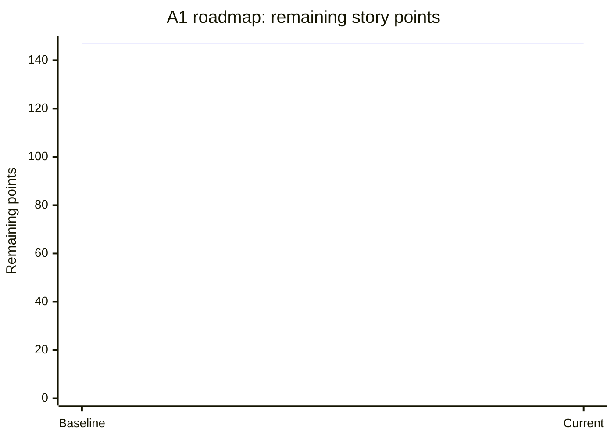

# Lumina A1 delivery roadmap and burndown

**Baseline:** 2026-11-04. **Scope:** 15 GitHub issues, **147 estimated story points**. All issues initially open. Estimates are planning approximations, not commitments. PR #3 remains draft and is **not** considered done.

## Burndown baseline

This chart records the *actual initial baseline only*. We will append a dated snapshot after each validated issue closure. We must not invent future velocity or mark a task done simply because code was pushed.

## Live backlog

[All open A1 roadmap issues](https://github.com/DKB2016/lumina-spanish/issues?q=is%3Aissue+is%3Aopen) · [All completed issues](https://github.com/DKB2016/lumina-spanish/issues?q=is%3Aissue+is%3Aclosed) · [Curriculum PR #3](https://github.com/DKB2016/lumina-spanish/pull/3)

| Priority | Issue | Deliverable | Points |
| --- | --- | --- | ---: |
| P0 | #4 | Build and regression verification | 3 |
| P0 | #5 | Objective grading and mastery gates | 5 |
| P0 | #6 | Adaptive missed-skill remediation | 8 |
| P1 | #7 | A1 CEFR-informed outcomes map | 8 |
| P1 | #8 | Eight authentic, complete A1 units | 13 |
| P1 | #9 | Unseen listening bank | 8 |
| P1 | #10 | Speech recording and ASR pipeline | 13 |
| P1 | #11 | Speaking rubric, calibrated feedback | 21 |
| P1 | #12 | Writing rubric, calibrated feedback | 13 |
| P1 | #13 | Four-skill A1 practice exams | 21 |
| P1 | #14 | Skill mastery analytics | 8 |
| P2 | #15 | Privacy, accessibility, offline assessment | 8 |
| P2 | #16 | Curriculum schema and CI validation | 5 |
| P2 | #17 | Pilot testing and release gates | 8 |
| P1 | #18 | Unit grades, skill breakdowns and retake recommendations | 5 |
| | | **Total** | **147** |

## Unit-level grading design

Unit score is computed from first-attempt objective results in graded lessons only. Unattempted lessons do not count as zero, and the UI displays coverage separately. Each unit displays lesson scores, listening/reading/sentence-building/usage skill breakdowns and weakest lessons to retake. The overall A1 grade is currently the average of graded lesson scores; future work will reconcile weighting and track best/latest attempts. Writing and speaking are excluded until validated grading exists. See [issue #18](https://github.com/DKB2016/lumina-spanish/issues/18).

## Speaking assessment architecture

1. Record short responses with microphone permission, clear privacy disclosure and playback.
2. Generate a Spanish transcript using an ASR engine tuned/tested on Mexican Spanish; include timestamps and uncertainty. Provide a correction interface, but distinguish edited text from original spoken evidence.
3. Score **communicative task completion, intelligibility, grammatical control, vocabulary appropriateness, fluency and interaction** against an explicit level-specific rubric. Acoustic pronunciation/fluency claims must use actual audio, not just the transcript.
4. Provide evidence-based feedback and targeted practice. Flag low-confidence evaluations for human review or abstain instead of inventing precision.
5. Benchmark against multiple human raters and diverse accents, speech rates, microphone conditions and learner backgrounds. Measure agreement, calibration and error rates before using scores for level decisions.

## Writing assessment architecture

1. Store prompt, learner draft, submitted version and revision history.
2. Score **task fulfillment, comprehensibility, vocabulary, grammar and coherence** against a published A1 rubric.
3. Provide targeted examples, explanations and suggested revisions, without silently replacing the learner's work.
4. Use independently human-scored responses as a calibration set; measure rubric agreement, consistency and bias.
5. Separate **formative coaching** from **high-stakes level assessment**. A generative model's unverified opinion is not an official CEFR certificate.

## Release rule

Issue closure requires acceptance criteria and test evidence, a merged PR, and documentation updates. Re-estimate or split oversized issues as necessary, recording scope changes explicitly. Never treat all four language skills as graded when only multiple-choice tasks are measured.
